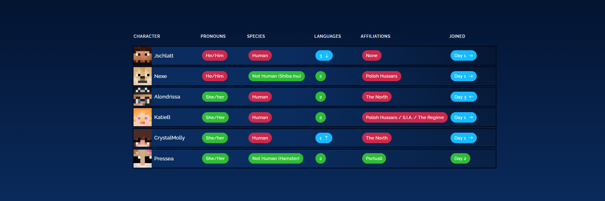

# ☑️ QSMPDLE 2.0

A daily character guessing game based on QSMP2.

🎮 Play now: [www.qsmpdle.com](https://www.qsmpdle.com)

**Built with:**

## Features

**Game Modes:**

- [x] Daily Mode
- [x] Practice Mode
- [x] Archive Mode

**User Interface:**

- [x] Responsive Mobile Layout
- [x] Optimized Image Loading
- [x] Advanced Animations

**Game State:**

- [x] Global Statistics
- [x] Anonymous Gameplay Analytics
- [x] Offline Progress Persistence
- [x] Personal Stats Page

## Privacy

QSMPDLE does not require accounts or collect personal information such as names, emails, passwords, or payment details.

Anonymous gameplay statistics are collected solely to improve balancing, understand player behavior, and monitor the health of the game.

Game progress is stored locally in your browser.

## Disclaimer

QSMPDLE is an unofficial fan project and is not affiliated with QSMP or its creators.
